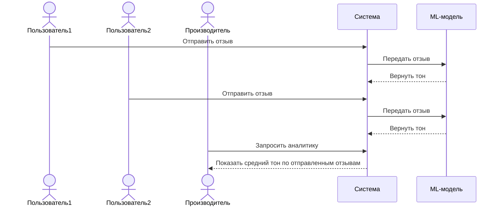
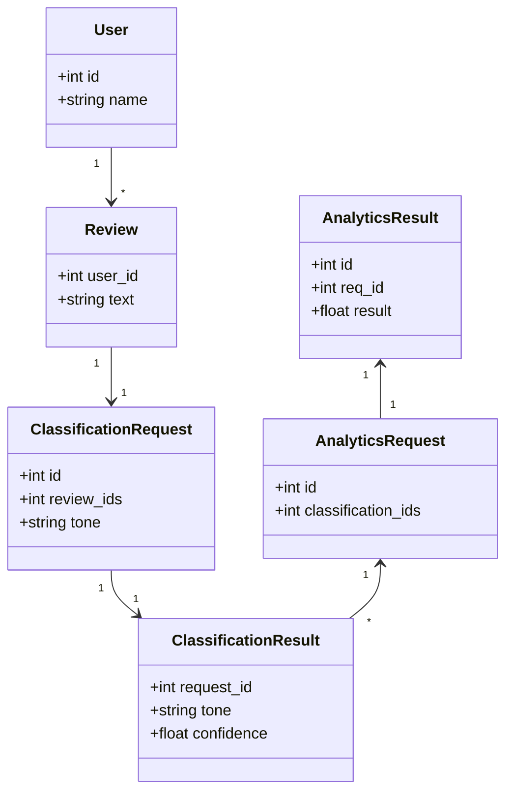

# Диаграммы

## Диаграмма последовательности

Не прописываю доступ к базе данных. Он подразумевается в нашей системе, т.к. где-то надо хранить информацию об обработанных отзывах. Мы это не вкладываем в продукт, однако, наверняка у вас уже есть своя бд для хранения отзывов. Туда же можно класть и результаты нашей системы.

## Диаграмма классов

